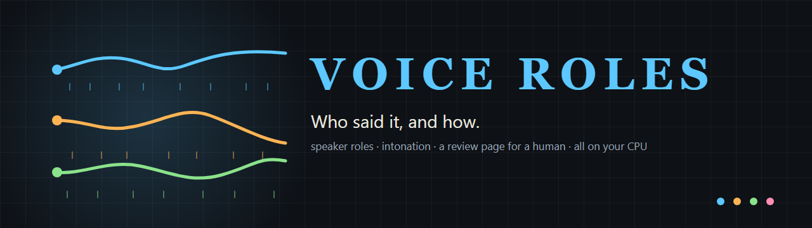
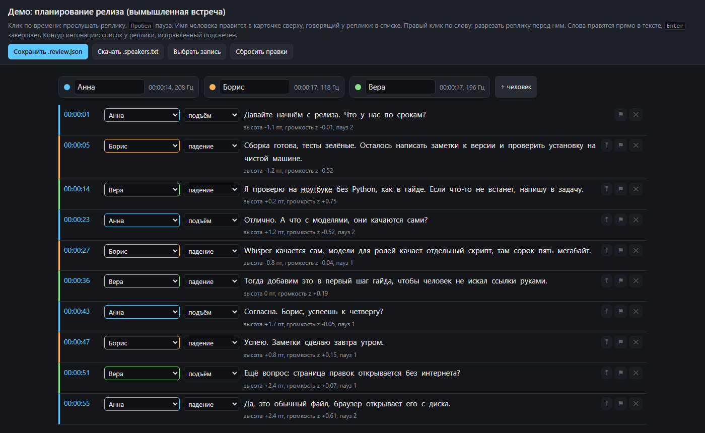

<p align="center">
  <picture>
    <source media="(prefers-color-scheme: light)" srcset="docs/media/banner-en-light.png">
    
  </picture>
</p>

<p align="center"><b>Who said it, and how.</b><br>
Speaker roles and intonation on top of Whisper, a review page for a human operator, voice profiles that learn from their corrections. Free, open, on your CPU.</p>

<p align="center">
  <a href="#start-here-if-you-have-never-installed-python">Start here</a> ·
  <a href="#how-it-works">How it works</a> ·
  <a href="#the-review-page">Review page</a> ·
  <a href="#calibration">Calibration</a> ·
  <a href="#benchmark">Benchmark</a> ·
  <a href="#security">Security</a> ·
  <a href="README.ru.md">Русский</a>
</p>

<p align="center">
  <a href="https://github.com/criocore/voice-roles/actions/workflows/ci.yml"></a>
  
  
  
  
  
  
  
</p>

<p align="center">
  
</p>

<p align="center"><a href="docs/demo/demo.review.html">Open the demo page</a> (download the file and open it in Chrome or Edge; a made-up meeting, no audio)</p>

```
git clone https://github.com/criocore/voice-roles.git
cd voice-roles
python -m venv venv
venv\Scripts\pip install -r requirements.txt
get_models.bat                                   # 45 MB of diarization models
transcribe.bat "C:\recordings\meeting.mp4" --speakers
```

Then open `meeting.review.html` next to the recording, fix what the machine got wrong, save `meeting.review.json` and drop it on `apply_review.bat`. From now on those people are recognised by voice.

## The recording never leaves the machine

Whisper, the diarization models and the pitch tracker run through CTranslate2 and onnxruntime on the CPU. No torch, no GPU, no API key, no cloud. A laptop with 8 cores transcribes an 18-minute meeting in about 13 minutes including roles and intonation; a recording of a team meeting, a lecture or an interview stays on the disk where it was.

## What you get

Next to `meeting.mp4`:

| file | content |
|---|---|
| `meeting.txt` | text with timestamps |
| `meeting.srt` | subtitles |
| `meeting.speakers.txt` | `[00:12:05] Anna: text of the turn`, with speech share and voice pitch per person in the header |
| `meeting.prosody.md` | one row per turn: contour (rise, fall, level), final slope, pitch height, loudness, pauses |
| `meeting.review.html` | the review page for a human operator, opens with a double click |
| `meeting.auto.json` | the untouched automatic result, used by the benchmark |

## How it works

1. **Text.** faster-whisper (medium by default) with word timestamps.
2. **Who spoke.** sherpa-onnx: pyannote-segmentation-3.0 finds speech regions, TitaNet-small turns each region into a 192-number voice embedding, clustering groups them. The number of people is found automatically: cluster at a high threshold (0.9), merge clusters whose voices match at cosine 0.8 and above, give short "ghost" clusters (under 15 s in total) to the nearest voice. Each word gets the speaker with the largest time overlap; a lone word of another speaker between two words of the same person is treated as a boundary error.
3. **How it was said.** SwiftF0 tracks pitch and loudness frame by frame. Pitch is converted to semitones from that person's own median, so a deep and a high voice are compared on the same scale. The slope of the last 300 ms gives the contour: rise, fall or level. Loudness is a z-score against the person's norm; pauses longer than 250 ms are counted.
4. **The operator.** The review page shows all of it, lets a person fix it, and the fixes feed back: voice profiles by name, contour thresholds, a benchmark table.

The project started from a hypothesis that pitch alone could tell speakers apart. A literature pass (over 200 sources, summarised in the Russian README) showed that it cannot: in the test meeting all four voices were male with medians of 116, 120, 124 and 142 Hz, while their embeddings differed at cosine 0.51 or less. Pitch is kept for what it is good at, intonation, on top of speaker labels that come from embeddings.

## Measured

One machine so far: Windows 11, Ryzen 7 5800H (8 cores, 16 threads), 30 GB RAM, no GPU. An 18-minute online meeting with four people, Russian.

| stage | medium model | small model |
|---|---|---|
| text (Whisper, word timestamps) | 634 s | about 150 s |
| roles (diarization, 8 threads) | 146 s, RTF 0.13 | 146 s |
| intonation (SwiftF0) | 6 s | 6 s |

| quality fact | value |
|---|---|
| people found without any hint | 4 of 4 |
| cosine between different speakers | 0.18 to 0.51 |
| same speaker, full meeting vs a 200-second cut | 0.88 to 0.96 |
| fixed `--clusters 4` vs the automatic merge pipeline | 82% of words agree, 18% of speech time differs, 10 boundaries missed |
| thresholds 0.8 and 0.95 vs the default 0.9 | 99% of words agree, same 4 people |

The last two rows come from `bench_quality.py --sweep`. A quality number against a human truth needs a human: run the benchmark after your first corrected recording, and please post the table in an issue with your CPU.

## The review page

A single HTML file with the transcript embedded. It reads the recording from the same folder through the browser (mp4, m4a, mp3, wav play directly; for mkv press "Choose recording" or convert first) and keeps unsaved edits in the browser's local storage.

| action | how |
|---|---|
| listen to a turn | click its time; Space pauses, Esc stops |
| rename a person | the cards at the top |
| change the speaker of a turn | the list next to the time; "+ new person" adds one |
| split a turn (two people in one) | right-click the first word of the second person |
| merge with the previous turn | ⤒ on the right, the speaker of the previous turn wins |
| fix a word | click it, type, Enter; an emptied word is removed |
| delete a turn (noise) | ✕ |
| fix the intonation contour | the list after the name; fixed ones get an amber frame |
| flag for later | ⚑ |

"Save .review.json" writes the corrected transcript next to the recording through the browser's save dialog. "Download .speakers.txt" gives the corrected text alone. "Reset" returns to the automatic result.

The page strings are Russian; the logic is language-free. A small i18n of the template is a welcome pull request.

## Calibration

Drop `meeting.review.json` on `apply_review.bat`. Three things happen:

- `.speakers.txt`, `.prosody.md` and the page itself are rebuilt from the corrected data.
- Every person with a real name (not "Спикер N") gets a voice profile in `voices/<name>.npy`: a TitaNet embedding of up to 60 s of their speech, up to 8 samples per name from different recordings. The next `transcribe.bat --speakers` labels those people by voice when the match is at least `--voice-sim` (0.6). A new sample under an existing name is refused when it does not match the stored ones (cosine under 0.55), which catches a name put on the wrong person.
- Contour labels go to `calibration/contours.json`. Once 30 labels exist with at least one correction, a grid search picks the slope and end-height thresholds that agree best with the operator and writes `calibration/contour_thresholds.json`; delete the file to return to the defaults.

Tips that came out of the first recordings:

- Fix the number of people first, names second, boundaries third, contours last. Words underlined with dots are the ones the machine was unsure about; most splits are needed there.
- One person split in two: raise `--threshold` to 0.95, or just reassign on the page and let the profile merge them next time. Two people merged: lower it to 0.8 or set `--clusters N`. One lecturer found as three: `--clusters 1`.
- Label contours only where you clearly hear a question or a full stop. Thirty honest labels beat three hundred guesses. Human agreement on intonation is low; 70 to 80% agreement with one operator is a realistic ceiling.
- Voice profiles need samples from more than one day and microphone before they recognise people reliably across sessions. The 0.6 threshold was set on one recording; report what works for you.

## Benchmark

Drop `meeting.review.json` on `bench_quality.bat`. The automatic result (`.auto.json`) is compared with the operator's truth and a table is appended to `calibration/bench.md`.

| metric | meaning | target |
|---|---|---|
| people: auto / operator | speaker count | equal |
| words with the right speaker | share of words given to the right person after the best "Спикер N" to name mapping | 90% and above for an online meeting |
| speech-time error | the same in seconds, a DER-like number | 5 to 10% is excellent; published systems sit at 10 to 20% DER on real meetings |
| names by voice correct | of the people labelled from `voices/`, how many right | 100% |
| missed / extra boundaries | the operator split a turn the machine had merged, and vice versa | a handful per hour |
| words edited / dropped | text errors, a Whisper matter | fewer with medium or large-v3 |
| contour agreement | turns whose contour matched the operator's label, with a confusion matrix | 70% and above; 100% with zero corrections means nothing |
| speed | seconds per stage and RTF | roles at RTF 0.13 on 8 cores |

`--sweep 0.7,0.8,0.9,0.95` and `--sweep-clusters 3,4,5` re-run diarization with other settings against the same truth, two and a half minutes per variant for an 18-minute file, and print the same metrics per variant.

## Start here (if you have never installed Python)

Windows steps; the Python code has nothing Windows-specific, only the `.bat` launchers are.

1. **Python 3.11 or newer** from [python.org/downloads](https://www.python.org/downloads/). In the installer tick "Add python.exe to PATH". Open a terminal (Win, type `cmd`, Enter) and check:
   ```
   python --version
   ```
2. **ffmpeg** extracts audio from video:
   ```
   winget install Gyan.FFmpeg
   ```
   Close and reopen the terminal, then `ffmpeg -version` must print a version. Without winget: download a build from gyan.dev, unpack, add its `bin` folder to PATH.
3. **The tool.** Code → Download ZIP on this page, unpack to a disk with 5 GB free (libraries 2 GB, Whisper medium 1.5 GB), or `git clone https://github.com/criocore/voice-roles.git`. In the terminal, inside that folder:
   ```
   python -m venv venv
   venv\Scripts\pip install --upgrade pip
   venv\Scripts\pip install -r requirements.txt
   ```
   If the system disk is nearly full, set `set PIP_CACHE_DIR=D:\pip-cache` first.
4. **Models.** Double-click `get_models.bat` (45 MB from the sherpa-onnx releases on GitHub). Whisper downloads itself on the first run.
5. **First run.** Cut two minutes of a recording, `ffmpeg -i meeting.mp4 -t 120 -c copy cut.mp4`, and run
   ```
   transcribe.bat cut.mp4 --speakers --model small
   ```
   A couple of minutes later `cut.speakers.txt` and `cut.review.html` appear next to the file. Then the full recording with the default medium model.

Useful flags: `--names "Anna,Boris,Vera"` (names in order of first appearance, only needed until voice profiles exist), `--clusters 4` (known number of people), `--threshold 0.9`, `--threads 8`, `--force`, `--voice-sim 0.6`.

## If something does not work

| symptom | cause and fix |
|---|---|
| `ffmpeg is not recognized` | not in PATH: reopen the terminal after installing, or add the `bin` folder |
| `No module named sherpa_onnx` | libraries were installed outside the venv: repeat step 3 |
| long silence at "Загрузка модели" | the first run downloads Whisper medium, 1.5 GB |
| error mentioning `model.int8.onnx` | diarization models are not in `models/diar`: run `get_models.bat` |
| the page opens but turns do not play | the recording is not in the same folder, or it is mkv: "Choose recording" |
| 20 people found | heavy noise or music: try `--threshold 0.95` and `--clusters N` |
| onnxruntime error with shapes like "12288 by 22474" | a voice sample longer than 2 minutes reached TitaNet; the code caps samples at 60 s, restore `EMB_MAX_SEC` if you changed it |
| `apply_review` says there are no real names | the cards still say "Спикер N": profiles are stored under real names only |

## Limits, and what would help

- Measured on one machine and a handful of Russian recordings. Benchmark tables from other CPUs, languages and recording types are the most useful contribution: see [CONTRIBUTING.md](CONTRIBUTING.md).
- Overlapping speech goes to one speaker; the page is where that gets fixed.
- Intonation is the shape of pitch, loudness and pauses, not emotion. Emotion recognition for Russian tops out around 0.54 macro-F1 in the literature and was left out on purpose.
- Only `.bat` launchers exist; `.sh` twins and a report from macOS or Linux would close that gap.
- The review page is Russian-only in its strings.

## Security

Nothing is sent anywhere; the only network access is the model download. Voice profiles in `voices/` identify people by voice and are kept out of git; treat them, and the transcripts, as personal data. Details and reporting: [SECURITY.md](SECURITY.md).

## Licenses

Code: MIT (`LICENSE`). Libraries and models belong to their authors: faster-whisper (MIT) and the Whisper weights (MIT, OpenAI); sherpa-onnx (Apache-2.0); pyannote-segmentation-3.0 (MIT, exported to ONNX by the sherpa-onnx team); TitaNet-small (NVIDIA NeMo, CC-BY-4.0); SwiftF0 under the terms in its own repository. Check the model cards before commercial use.

## A note from the author

voice-roles was built by one person together with an AI coding agent (Claude Code) in one long day, starting from a question about their own meeting recordings, and is shared in good faith. It is not a surveillance tool and not a judgement of anyone's speech; use it on recordings you are allowed to process, and tell the people in them. If something here is wrong or hurts someone's rights, open an issue and it will be fixed.

<p align="center">Built with Claude Code · checked on Windows · <a href="README.ru.md">Русская версия</a></p>
