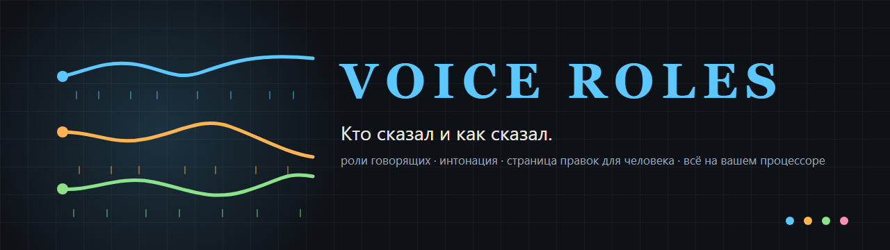
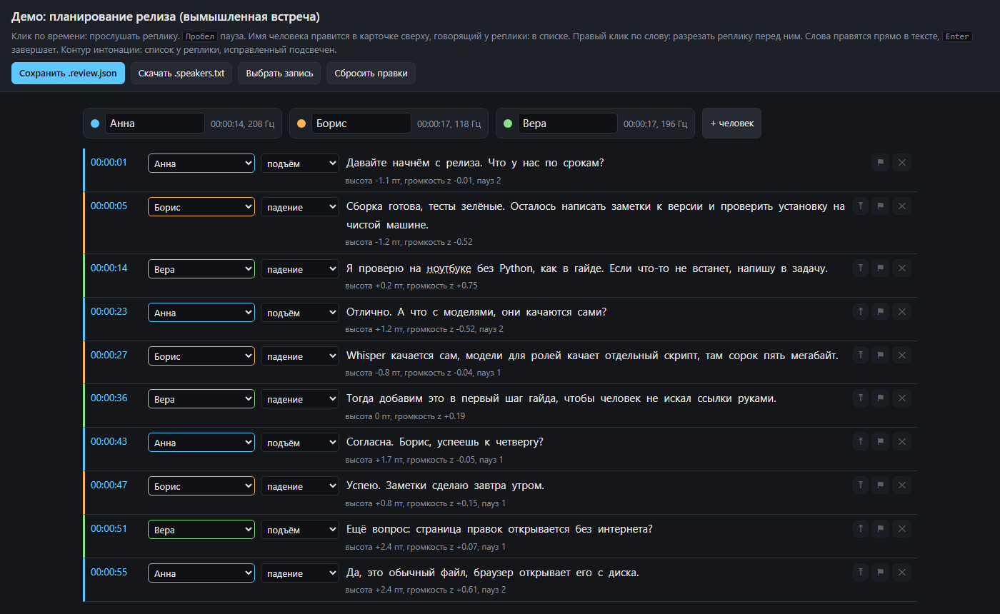

<p align="center">
  <picture>
    <source media="(prefers-color-scheme: light)" srcset="docs/media/banner-ru-light.png">
    
  </picture>
</p>

<p align="center"><b>Кто сказал и как сказал.</b><br>
Роли говорящих и интонация поверх Whisper, страница правок для человека, профили голосов, которые учатся на его исправлениях. Бесплатно, открыто, на вашем процессоре.</p>

<p align="center">
  <a href="#с-чего-начать-если-вы-никогда-не-ставили-python">С чего начать</a> ·
  <a href="#как-это-устроено">Как устроено</a> ·
  <a href="#страница-правок">Страница правок</a> ·
  <a href="#калибровка">Калибровка</a> ·
  <a href="#бенчмарк">Бенчмарк</a> ·
  <a href="#безопасность">Безопасность</a> ·
  <a href="README.md">English</a>
</p>

<p align="center">
  <a href="https://github.com/criocore/voice-roles/actions/workflows/ci.yml"></a>
  
  
  
  
  
  
  
</p>

<p align="center">
  
</p>

<p align="center"><a href="docs/demo/demo.review.html">Открыть демо-страницу</a> (скачать файл и открыть в Chrome или Edge; встреча вымышленная, без звука)</p>

```
git clone https://github.com/criocore/voice-roles.git
cd voice-roles
python -m venv venv
venv\Scripts\pip install -r requirements.txt
get_models.bat                                   # 45 МБ моделей для ролей
transcribe.bat "C:\записи\встреча.mp4" --speakers
```

Потом открыть `встреча.review.html` рядом с записью, поправить, что машина перепутала, сохранить `встреча.review.json` и перетащить его на `apply_review.bat`. С этого момента эти люди узнаются по голосу.

## Запись не покидает компьютер

Whisper, модели ролей и трекер тона работают через CTranslate2 и onnxruntime на процессоре. Без torch, без видеокарты, без ключей и облака. Ноутбук с восемью ядрами расшифровывает 18-минутную встречу примерно за 13 минут вместе с ролями и интонацией, а запись планёрки, лекции или интервью остаётся на том диске, где лежала.

## Что получится на выходе

Рядом с `встреча.mp4`:

| файл | что внутри |
|---|---|
| `встреча.txt` | текст с метками времени |
| `встреча.srt` | субтитры |
| `встреча.speakers.txt` | `[00:12:05] Анна: текст реплики`, в шапке доля речи и высота голоса каждого |
| `встреча.prosody.md` | строка на реплику: контур (подъём, падение, ровно), наклон тона, высота, громкость, паузы |
| `встреча.review.html` | страница правок для оператора, открывается двойным кликом |
| `встреча.auto.json` | нетронутый результат автомата, нужен бенчмарку |

## Как это устроено

1. **Текст.** faster-whisper (по умолчанию medium) с временем каждого слова.
2. **Кто говорил.** sherpa-onnx: pyannote-segmentation-3.0 находит участки речи, TitaNet-small превращает каждый в отпечаток голоса из 192 чисел, кластеризация собирает их по людям. Число людей находится само: кластеризация с высоким порогом (0.9), потом слияние голосов со сходством от 0.8, потом короткие "призраки" (меньше 15 с речи суммарно) уходят к ближайшему голосу. Слово получает говорящего по наибольшему перекрытию во времени; одиночное слово чужого человека между двумя словами одного считается ошибкой границы.
3. **Как говорил.** SwiftF0 считает тон и громкость по кадрам. Тон переводится в полутоны от медианы этого человека, так низкий и высокий голос сравниваются в одной шкале. Наклон последних 300 мс даёт контур: подъём, падение или ровно. Громкость считается как z-оценка от нормы человека, паузы длиннее 250 мс считаются.
4. **Оператор.** Страница правок показывает всё это, даёт человеку исправить, а исправления возвращаются в инструмент: профили голосов по именам, пороги контуров, таблица бенчмарка.

### Что показал ресёрч

Проект начался с гипотезы: разложить звук по высоте голоса, по высоте понять роли, потом учить интонацию. Обзор больше чем 200 источников (статьи, репозитории, бенчмарки) показал, что гипотеза права наполовину.

- Высота тона сама по себе слабо отличает людей: в одной старой работе ошибка идентификации по F0 на 180 телефонных голосах была 89%. На тестовой встрече все четыре голоса мужские, медианы 116, 120, 124 и 142 Гц.
- Отпечатки голоса (ECAPA, CAM++, ResNet, TitaNet) дают EER 0.65 до 1.1% на VoxCeleb и уже содержат информацию о высоте: по ним класс высоты угадывается с точностью 81 до 86%. Поэтому роли считаются по отпечаткам, а высота остаётся для интонации.
- Про интонацию гипотеза верна: F0 в полутонах от медианы своего голоса плюс громкость, паузы и темп поверх меток говорящих, это стандартный способ в просодических работах.
- Готового классификатора русских интонационных конструкций (ИК-1 до ИК-7) для скачивания нет. Распознавание эмоций на русском упирается примерно в 0.54 macro-F1 (Dusha, подкасты), а сами люди соглашаются об эмоции слабо (каппа Флейсса 0.23 на MSP-Podcast). Поэтому эмоции в инструмент не вошли.
- Стек без torch и без токенов Hugging Face: sherpa-onnx (сегментация pyannote int8 1.5 МБ плюс эмбеддер), привязка слов по перекрытию как в WhisperX, SwiftF0 (numpy плюс onnxruntime, лучший F1 из 19 трекеров тона, 180 раз быстрее реального времени на одном ядре).

## Замеры

Пока одна машина: Windows 11, Ryzen 7 5800H (8 ядер, 16 потоков), 30 ГБ памяти, без видеокарты. Онлайн-встреча 18 минут, четыре человека, русский.

| этап | модель medium | модель small |
|---|---|---|
| текст (Whisper с временем слов) | 634 с | около 150 с |
| роли (диаризация, 8 потоков) | 146 с, RTF 0.13 | 146 с |
| интонация (SwiftF0) | 6 с | 6 с |

| факт о качестве | значение |
|---|---|
| людей найдено без подсказки | 4 из 4 |
| сходство между разными людьми (косинус) | 0.18 до 0.51 |
| один человек: вся встреча против куска в 200 с | 0.88 до 0.96 |
| жёсткий `--clusters 4` против автоматической склейки | 82% слов совпало, 18% времени речи разошлось, 10 границ пропущено |
| пороги 0.8 и 0.95 против 0.9 по умолчанию | 99% слов совпало, те же 4 человека |

Две последние строки из `bench_quality.py --sweep`. Цифра качества относительно правды требует человека: прогоните бенчмарк после первой исправленной записи и, если не трудно, выложите таблицу в issue вместе с моделью процессора.

## Страница правок

Один HTML-файл с расшифровкой внутри. Запись он берёт из той же папки через браузер (mp4, m4a, mp3, wav играют сразу; для mkv нажмите "Выбрать запись" или заранее сделайте `ffmpeg -i встреча.mkv -vn встреча.m4a`), несохранённые правки держит в локальном хранилище браузера.

| действие | как |
|---|---|
| прослушать реплику | клик по времени; пробел пауза, Esc стоп |
| переименовать человека | карточки сверху |
| сменить говорящего у реплики | список рядом с временем; "+ новый человек" добавляет ещё одного |
| разрезать реплику (два человека в одной) | правый клик по первому слову второго человека |
| склеить с предыдущей | ⤒ справа, говорящий остаётся от предыдущей |
| исправить слово | клик, ввод, Enter; пустое слово удаляется |
| удалить реплику (шум) | ✕ |
| исправить контур интонации | список после имени; исправленные в янтарной рамке |
| пометить "вернусь позже" | ⚑ |

"Сохранить .review.json" пишет исправленную расшифровку рядом с записью через диалог браузера. "Скачать .speakers.txt" отдаёт только исправленный текст. "Сбросить правки" возвращает автоматический результат.

Порядок, который экономит время:

1. Шапка: сколько людей нашлось. Лишний "Спикер 5" с парой реплик это обычно наложение голосов или шум; переназначьте его реплики, карточка опустеет.
2. Имена в карточках. Высота голоса в Гц помогает отличить людей, но не заменяет прослушивание.
3. Реплики с пунктиром под словами: это слова на границе смены говорящего, там чаще всего нужен правый клик "разрезать".
4. Контуры: слушайте и правьте только там, где чётко слышен вопрос или точка. Для подстройки хватает 30 честных меток.

## Калибровка

Перетащите `встреча.review.json` на `apply_review.bat`. Происходит три вещи:

- `.speakers.txt`, `.prosody.md` и сама страница пересобираются по исправленным данным.
- Каждый человек с настоящим именем (не "Спикер N") получает профиль голоса в `voices\Имя.npy`: отпечаток TitaNet по 60 с его речи, до 8 образцов на имя с разных записей. Следующий `transcribe.bat --speakers` подписывает этих людей по голосу, когда сходство не ниже `--voice-sim` (0.6). Новый образец под старым именем не записывается, если не похож на сохранённые (косинус ниже 0.55): так ловится имя, поставленное не тому человеку.
- Метки контуров копятся в `calibration\contours.json`. Когда их 30 и больше и есть хотя бы одно исправление, перебор подбирает пороги наклона и высоты концовки, которые лучше сходятся с оператором, и пишет `calibration\contour_thresholds.json`; удалите файл, чтобы вернуть исходные.

Советы из первых записей:

- Сначала число людей, потом имена, потом границы, контуры в конце.
- Один человек разбит на двоих: поднимите `--threshold` до 0.95 или просто переназначьте на странице, профиль склеит их в следующий раз. Два человека слиты: опустите до 0.8 или задайте `--clusters N`. Один лектор найден как трое: `--clusters 1`.
- Профилям нужны образцы с разных дней и микрофонов, прежде чем они надёжно узнают людей между сессиями. Порог 0.6 подобран на одной записи; напишите, что сработало у вас.
- Про интонацию: совпадение 70 до 80% с одним оператором реально, 100% нет. Эмоции инструмент не определяет, только форму тона, громкость и паузы.
- Плохой текст портит и роли: для русского обычно достаточно medium, large-v3 точнее и в 2 раза дольше. Длинные записи с музыкой режьте на части по часу.

## Бенчмарк

Перетащите `встреча.review.json` на `bench_quality.bat`. Автомат (`.auto.json`) сравнивается с правдой оператора, таблица дописывается в `calibration\bench.md`, так виден прогресс по датам.

| метрика | что значит | ориентир |
|---|---|---|
| людей: авто / по оператору | число людей | должно совпасть |
| слова с верным говорящим | доля слов, отданных правильному человеку после лучшего сопоставления "Спикер N" с именами | 90% и выше для онлайн-встречи |
| ошибка по времени речи | то же в секундах, аналог DER | 5 до 10% отлично; опубликованные системы дают 10 до 20% DER на реальных встречах |
| имена по голосу верны | из людей, подписанных по `voices`, сколько верно | 100% |
| пропущенные / лишние границы | оператор разрезал реплику, которую автомат склеил, и наоборот | единицы на час |
| слова исправлены / удалены | ошибки текста, вопрос к Whisper | меньше с medium и large-v3 |
| контур совпал | реплики, где контур совпал с меткой оператора, плюс матрица ошибок | 70% и выше; 100% при нуле исправлений ничего не значит |
| скорость | секунды на этап и RTF | роли RTF 0.13 на 8 ядрах |

`--sweep 0.7,0.8,0.9,0.95` и `--sweep-clusters 3,4,5` заново считают роли с другими настройками против той же правды, по 2,5 минуты на вариант для 18-минутного файла, и печатают те же метрики по вариантам.

## С чего начать (если вы никогда не ставили Python)

Шаги для Windows; в самом коде ничего виндового нет, только запускалки `.bat`.

1. **Python 3.11 или новее** с [python.org/downloads](https://www.python.org/downloads/). В установщике поставьте галочку "Add python.exe to PATH". Откройте командную строку (Win, набрать `cmd`, Enter) и проверьте:
   ```
   python --version
   ```
2. **ffmpeg** вытаскивает звук из видео:
   ```
   winget install Gyan.FFmpeg
   ```
   Закройте и откройте командную строку заново, `ffmpeg -version` должен напечатать версию. Без winget: скачайте сборку с gyan.dev, распакуйте, папку `bin` добавьте в PATH.
3. **Инструмент.** Кнопка Code, Download ZIP на этой странице, распакуйте на диск, где есть 5 ГБ (библиотеки 2 ГБ, Whisper medium 1,5 ГБ), или `git clone https://github.com/criocore/voice-roles.git`. В командной строке внутри папки:
   ```
   python -m venv venv
   venv\Scripts\pip install --upgrade pip
   venv\Scripts\pip install -r requirements.txt
   ```
   Если системный диск почти полон, сначала `set PIP_CACHE_DIR=D:\pip-cache`.
4. **Модели.** Двойной клик по `get_models.bat` (45 МБ из релизов sherpa-onnx на GitHub). Whisper скачается сам при первом прогоне.
5. **Первый прогон.** Вырежьте две минуты записи, `ffmpeg -i встреча.mp4 -t 120 -c copy кусок.mp4`, и запустите
   ```
   transcribe.bat кусок.mp4 --speakers --model small
   ```
   Через пару минут рядом появятся `кусок.speakers.txt` и `кусок.review.html`. Дальше полная запись с моделью medium по умолчанию.

Ключи: `--names "Анна,Борис,Вера"` (имена по порядку первого появления, нужен только пока нет профилей), `--clusters 4` (известное число людей), `--threshold 0.9`, `--threads 8`, `--force`, `--voice-sim 0.6`.

Раскладка папки после установки:

```
voice-roles\
  transcribe.bat, transcribe.py, speakers.py, review_template.html
  apply_review.bat, apply_review.py
  bench_quality.bat, bench_quality.py
  get_models.bat, get_models.py, requirements.txt
  venv\
  models\
    diar\sherpa-onnx-pyannote-segmentation-3-0\model.int8.onnx
    diar\nemo_en_titanet_small.onnx
    (сюда же Whisper скачает свои папки)
  voices\          появится после первой правки, профили голосов по именам
  calibration\     появится после первой правки, метки контуров, пороги, журнал бенчмарка
```

## Если что-то не работает

| симптом | причина и что делать |
|---|---|
| `ffmpeg не является внутренней или внешней командой` | не в PATH: переоткройте командную строку после установки или добавьте папку `bin` |
| `No module named sherpa_onnx` | библиотеки ставились не в venv: повторите шаг 3 |
| долгое молчание при "Загрузка модели" | первый прогон качает Whisper medium, 1,5 ГБ |
| ошибка про `model.int8.onnx` | модели ролей не в `models\diar`: запустите `get_models.bat` |
| страница открылась, но реплики не играют | запись не в той папке или это mkv: "Выбрать запись" |
| нашлось 20 человек | сильный шум или музыка: попробуйте `--threshold 0.95` и `--clusters N` |
| ошибка onnxruntime с числами вроде "12288 by 22474" | в TitaNet попал образец длиннее 2 минут; код режет до 60 с, верните `EMB_MAX_SEC`, если меняли |
| `apply_review` пишет "настоящих имён нет" | в карточках остались "Спикер N": профили пишутся только под настоящими именами |
| диск C заполнился | модели и кэш pip на системном диске: перенесите папку на другой диск и задайте `PIP_CACHE_DIR` |

## Ограничения и чем помочь

- Замеры на одной машине и нескольких русских записях. Таблицы бенчмарка с других процессоров, языков и типов записей самый полезный вклад: [CONTRIBUTING.md](CONTRIBUTING.md).
- Наложение голосов уходит одному человеку; это чинится на странице.
- Интонация это форма тона, громкость и паузы, не эмоция. Распознавание эмоций для русского упирается в 0.54 macro-F1 и оставлено за бортом намеренно.
- Запускалки только `.bat`; близнецы `.sh` и отчёт с macOS или Linux закрыли бы этот пробел.
- Строки страницы правок только русские.

## Безопасность

Никуда ничего не отправляется, сеть нужна только для скачивания моделей. Профили в `voices\` опознают людей по голосу и в git не попадают; относитесь к ним и к расшифровкам как к персональным данным. Подробности и как сообщить об уязвимости: [SECURITY.md](SECURITY.md).

## Лицензии

Код: MIT (`LICENSE`). Библиотеки и модели принадлежат авторам: faster-whisper (MIT) и веса Whisper (MIT, OpenAI); sherpa-onnx (Apache-2.0); pyannote-segmentation-3.0 (MIT, экспорт в ONNX от команды sherpa-onnx); TitaNet-small (NVIDIA NeMo, CC-BY-4.0); SwiftF0 на условиях его репозитория. Перед коммерческим использованием проверьте карточки моделей.

## От автора

voice-roles сделан одним человеком вместе с ИИ-агентом (Claude Code) за один длинный день, начиная с вопроса к собственным записям встреч, и выложен по-честному. Это не инструмент слежки и не оценка чьей-то речи: обрабатывайте записи, на которые у вас есть право, и говорите об этом людям на них. Если что-то здесь неверно или задевает чьи-то права, откройте issue, и это будет исправлено.

<p align="center">Сделано с Claude Code · проверено на Windows · <a href="README.md">English version</a></p>
